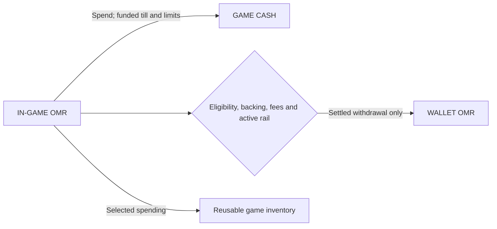
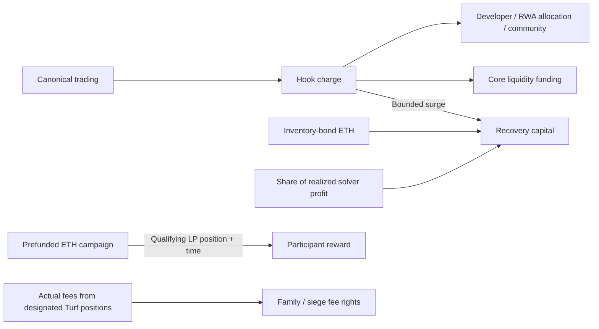

# Economy evidence — OMERTÀ: Trust Is the Game

Reviewed September 29, 2026 against source `3280817300cdcff3301745b1fce0bac9fe290129` (September 26). This shard inspected source and retained documentation. It did not transact, inspect credentials, establish current chain activation, run a new security audit or change gameplay code. The current market is the sole model. Use **OMERTÀ market** in public copy; retain version suffixes only in exact technical identifiers and source links.

[Machine-readable claims](claims-economy.json) contains **ECO-01–ECO-25**, supported narration, depictions, blockers and pinned sources: **0 LIVE; 22 IMPLEMENTED; 1 PLANNED; 2 UNVERIFIED**. External Stock Token rights/terminology were checked in official documentation; OMERTÀ recipient eligibility/delivery remains unverified.

The market design separates implementation from deployment, funding and activation. The retained September 11 deployment snapshot is dormant and does not establish the current market's runtime. It cannot support a “now earning” scene. [Market scope](https://github.com/OmertaDev/Omerta/blob/3280817300cdcff3301745b1fce0bac9fe290129/omerta-contracts/docs/market/DESIGN.md#L1-L5); [release requirements](https://github.com/OmertaDev/Omerta/blob/3280817300cdcff3301745b1fce0bac9fe290129/omerta-contracts/docs/market/RUNBOOK.md#L72-L74); [retained dormant snapshot](https://github.com/OmertaDev/Omerta/blob/3280817300cdcff3301745b1fce0bac9fe290129/omerta-contracts/deployments/4663/manifest.json#L255-L262).

## Priority for the 85-second chapter

Explain **who owns what and which action changes it**: three balances → useful game spending → conditional extraction → funded market → Family fee rights → conditional RWA ambition. Death/extraction can move to the adjacent loss chapter. Rates, individual contract names, seven compartments and reward formulas belong in secondary notes.

Use a persistent, legible **IMPLEMENTED RULES · ACTIVATION UNVERIFIED** heading during onchain diagrams. For the complete RWA pipeline use **PLANNED CONNECTION · ELIGIBILITY REQUIRED**. Treat these as diagram headings, readable for the whole sequence, not a closing legal slide.

## Proposed narration — 192 words

Three balances. Three rules.

Game cash pays for city life. In-game OMR buys selected equipment, access and services. Wallet OMR lives onchain.

The funded Window moves OMR into game cash. There is no reverse cash-to-OMR conversion. Missions award limited game OMR; funded pools can distribute rewards. That is not an automatic wallet payout.

Withdrawal needs eligibility, backing and an active chain rail. Fresh balances cost more to extract. Eligible gear and vehicles can leave too. Once exported, they stop working in-game. Combat cannot seize an unrelated external wallet.

The implemented market routes trading fees through a Uniswap hook into separate budgets. Inventory bonds sell OMR already held. LP rewards need qualifying positions and funded campaigns. Successful arbitrage contributes a share of actual profit.

Families compete for designated liquidity-fee rights. The pool's principal stays protocol-controlled.

Many game spends recycle OMR. They do not permanently burn token supply. The token retains controlled mint authority.

The RWA ambition includes approved Stock Tokens, Commission choices and eligible allocations. Assets must actually be bought, held and delivered. That complete pipeline is not established live.

Each mechanism grants specific rights. Holding OMR does not grant everyone a payout.

At approximately 144 words/minute, this leaves five seconds for transitions within 85 seconds. If more breathing room is needed, move the asset-extraction sentences to the death/legacy chapter. Game footage still needs a clear development-build status.

## Diagram 1 — Three balances, different exits

**ECO-02–06, ECO-16–19. Suggested duration: 22–28 seconds across two builds.**

Start with three equally legible compartments. Label cash **GAME CURRENCY**, not USD. Draw the one-way Window, with no reverse cash-to-OMR arrow. Do not invent an inbound wallet-deposit bridge for visual symmetry.

Extraction is a separate gate. An internal reward stays inside the game until a valid, funded chain claim settles. Queueing is **PENDING**, not payment. For the loss sentence, shade risk only over game custody; label the unrelated external wallet **OUTSIDE GAME COMBAT**, never “risk-free.”

Optional adjacent item strip: **ELIGIBLE GEAR / VEHICLE → WALLET → INACTIVE IN GAME**. This is an asset-specific export rail, not the Window or universal NFT support.

“Reusable game inventory” means backend Desk accounting. It is not the controller's same-named liquidity compartment; a shared name does not prove a transfer.

[Value domains and bounded rewards](https://github.com/OmertaDev/Omerta/blob/3280817300cdcff3301745b1fce0bac9fe290129/docs/investors/02-technical-detail.md#L86-L107); [Window movements](https://github.com/OmertaDev/Omerta/blob/3280817300cdcff3301745b1fce0bac9fe290129/src/exchange.js#L174-L202); [withdrawal and queue](https://github.com/OmertaDev/Omerta/blob/3280817300cdcff3301745b1fce0bac9fe290129/src/chain.js#L225-L294); [NFT distinctions](https://github.com/OmertaDev/Omerta/blob/3280817300cdcff3301745b1fce0bac9fe290129/docs/investors/02-technical-detail.md#L199-L211).

## Diagram 2 — Funded rights, separate flows

**ECO-07–14. Suggested duration: 25–32 seconds, revealing one row at a time.**

Keep three graphic rows distinct:

1. **Market funding:** Hook charge → recipients, Core and recovery capital. If rates appear, the implemented base sell charge is **9%: 2% developer + 1.6% RWA allocation + 2.4% community + 3% POL**, plus a separate **0–1% surge** for stability. Ordinary LP fees are additional. Normal buys after the opening window have no Hook buy tax. Label this **implemented policy**, not verified live terms. Fees can settle in ETH or OMR. Independent venues may have different policies.
2. **LP campaign:** an eligible position NFT + measured useful liquidity + time → finite prefunded ETH. No arrow from mere OMR holding to this reward. The mature position can return when reward funding is exhausted; its market value is not guaranteed.
3. **Family Turf:** actual fees from a designated position → historical Family credits / funded siege escrow. Keep **LP PRINCIPAL** behind a distinct boundary. Winning does not grant a Family withdrawal authority over the pool.

The VO can omit percentages. Send only the configured share of **realized profit**, never gross solver turnover, to recovery capital. Funding does not reset exhausted lifetime budgets. Avoid guaranteed floors, rising-price arrows and universal dividends.

[Fee policy and capital constraints](https://github.com/OmertaDev/Omerta/blob/3280817300cdcff3301745b1fce0bac9fe290129/docs/investors/02-technical-detail.md#L26-L52); [inventory bonds and LP campaigns](https://github.com/OmertaDev/Omerta/blob/3280817300cdcff3301745b1fce0bac9fe290129/docs/investors/02-technical-detail.md#L54-L66); [Turf and solver accounting](https://github.com/OmertaDev/Omerta/blob/3280817300cdcff3301745b1fce0bac9fe290129/docs/investors/02-technical-detail.md#L68-L74).

## RWA ending — 8–12 seconds, incomplete connection

**ECO-20–25:** approved asset → Commission decision → bounded purchase → actual custody → eligible allocation → confirmed delivery. Use dashed connections and **PLANNED CONNECTION**; do not animate the complete pipeline as settled transactions.

Ballot/catalog controls, a bounded buyer, allocation bookkeeping and StockVault delivery are implemented pieces. They do not complete the acquisition constellation: `AcquisitionAuthority.unpause()` explicitly fails readiness, while `AcquisitionIntentExecution` provides identity/topology groundwork. An RWA fee destination is not a stock purchase. The treasury ETH allocation ledger separately implements no player ETH payout.

An allocation can wait when no valid extracted StreetDeed delivery target exists. The destination is a deed's token-bound account, not an automatic dividend attached to every portrait, NFT or OMR balance. Deed contents can change before sale.

[Components and incomplete execution](https://github.com/OmertaDev/Omerta/blob/3280817300cdcff3301745b1fce0bac9fe290129/docs/investors/02-technical-detail.md#L315-L335); [fail-closed authority](https://github.com/OmertaDev/Omerta/blob/3280817300cdcff3301745b1fce0bac9fe290129/omerta-contracts/src/AcquisitionAuthority.sol#L589-L593); [delivery target and dormancy](https://github.com/OmertaDev/Omerta/blob/3280817300cdcff3301745b1fce0bac9fe290129/src/stockdeliver.js#L11-L34); [internal ETH allocation limitation](https://github.com/OmertaDev/Omerta/blob/3280817300cdcff3301745b1fce0bac9fe290129/src/treasury.js#L30-L36).

Use **Stock Tokens** in public wording. Official Robinhood documentation describes exposure through debt securities, not ownership of underlying company shares, and restricts US/US-person delivery. Its terms prescribe “Stock Tokens” or “tokenized real-world assets such as Stock Tokens” for external copy. The film need not list jurisdictions aloud; it must not promise universal delivery. [Official product](https://docs.robinhood.com/chain/stock-tokens/); [official terminology, §2.3(j)](https://docs.robinhood.com/chain/terms-of-service/) (checked September 29).

## Secondary facts

- **OMR utility is not all cosmetic.** Equipment and some holding/access benefits have mechanical effects. Finite mission awards are internal credits, not automatic wallet payouts. [Utility](https://github.com/OmertaDev/Omerta/blob/3280817300cdcff3301745b1fce0bac9fe290129/docs/investors/01-plain-language.md#L31-L43).
- **No hard supply cap claim.** The founding mint is 100 million; the owner-controlled minter remains. Inventory sales do not remove separate issuance authority. Present mint configuration and circulating supply need current chain evidence. [Mint implementation](https://github.com/OmertaDev/Omerta/blob/3280817300cdcff3301745b1fce0bac9fe290129/omerta-contracts/src/OMR.sol#L116-L139).
- **Death is not “lose everything.”** Eligible base player-kill rules can loot 50% liquid/unbonding and 20% staked game OMR; duty then applies to remaining liquid/unbonding. Eligibility, protection and modifiers matter. Wallet OMR is outside that game-balance calculation. Prefer this boundary over percentage arithmetic in the master. [Death and persistence](https://github.com/OmertaDev/Omerta/blob/3280817300cdcff3301745b1fce0bac9fe290129/docs/investors/02-technical-detail.md#L169-L186).
- **Exit costs differ.** Documented default withdrawal toll is 2%, plus a fresh-balance surcharge starting at 50% and declining to zero over 48 hours. These are additive, with fresh-first lot accounting. Later sales separately incur applicable market fees, slippage and gas. Queue cancellation does not return the charged toll. [Extraction rules](https://github.com/OmertaDev/Omerta/blob/3280817300cdcff3301745b1fce0bac9fe290129/docs/investors/02-technical-detail.md#L237-L267).
- **Reward custody differs.** Family reserves, personal withdrawal reserves, LP-campaign ETH and Stock Token units are not one cash-out pool. OMR does not grant automatic company ownership, universal dividends or a proportional claim to all protocol assets. [Holder rights](https://github.com/OmertaDev/Omerta/blob/3280817300cdcff3301745b1fce0bac9fe290129/docs/investors/01-plain-language.md#L9-L11); [custody boundaries](https://github.com/OmertaDev/Omerta/blob/3280817300cdcff3301745b1fce0bac9fe290129/docs/investors/02-technical-detail.md#L261-L281).
- **THE BANK is separately gated.** It has its own collateral/debt, realized-yield, asset, vault, funding and activation scope. It is unnecessary for these two diagrams. [Bank scope](https://github.com/OmertaDev/Omerta/blob/3280817300cdcff3301745b1fce0bac9fe290129/docs/investors/02-technical-detail.md#L285-L311).

## Publication blockers

A live revision needs evidence for exact source/runtime, recipients, canonical pool, funded positions/rewards, signer/adapter authority, settled operations and recipient eligibility. Source, passing tests, website copy and a dormant deployment do not establish those facts. Until then, use source-based diagrams and identified development footage; never fabricate explorer receipts or earned balances.

