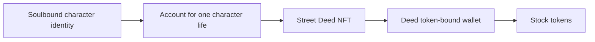

**Character and deed policy — 14 October 2026**

Owner decisions: character NFTs are soulbound; at most 2,500 unique Street Deeds may ever be issued; a player killer receives the victim's deeds together with the assets those deeds hold. The stock-token recipient remains each Street Deed's own token-bound account.

The source now enforces ERC-5192 permanent locking on `DynastyNFT`. Minting, signed-voucher checks and metadata remain available. Existing portrait snapshots and indexer reconciliation remain for historical data; the new contract cannot create owner-to-owner transfers. Existing immutable deployments do not acquire soulbinding from this source change.

The deed limit counts identities, including extracted and redeemed deeds. A transfer, death, burn-back into the game, or re-extraction of the same street does not free or consume an additional identity slot. Onchain enforcement is a fixed 2,500 maximum and monotonic unique-street counter. In-game creation uses a serialized lifetime counter seeded from existing streets, including extracted rows. Current acquisition eligibility remains unchanged; this change does not introduce a new auction or release schedule.

The character identity currently represents an account's bloodline and persists across generations. The proposed custody system gives each mortal character life its own account while retaining that persistent soulbound identity:

On a confirmed player kill, deed ownership moves from the victim-life account to the killer-life account. The deed's stock-wallet address and contents stay attached to the same deed. A distinct account per life prevents delayed settlement from sending a dead character's loot to its heir. If the killer subsequently dies, unsettled deeds must follow that killer life's recorded destination; they cannot be assigned to a later generation.

That custody/death route is a design, not implemented or activated by the soulbound and scarcity changes. Its implementation needs typed lifecycle authorization, canonical account registration, replay protection, durable death outbox records inside the gameplay transaction, confirmed-chain settlement, and nested-owner support in stock delivery and deed reimport. An ordinary token-bound wallet with unrestricted execution cannot by itself enforce forfeiture on an offchain game death.

Two policy choices remain pending:

- Whether equipped deeds and their stocks are locked until authorized unequip, or freely withdrawable with only remaining assets exposed to loot. A lock needs an enforceable safe-exit process; expiry alone cannot make a previously signed exit safe after combat resumes.
- Where deeds go after a death with no player killer: estate escrow, world redistribution, or retention by the player.

The keeper must use the actual killer identity recorded by the game, not a display name. Character death saves do not settle loot. A killer without a claimed identity NFT needs pending loot rights until its canonical account exists; an absent NFT must not silently redirect the assets to a treasury. Any eventual public event design must preserve the game's separation of private character identities and wallet addresses.

No custody migration, stock transfer, deployment or activation is authorized by an unsigned design document or passing source tests. The changed source requires exact deployment verification and the affected release review before funded use.
