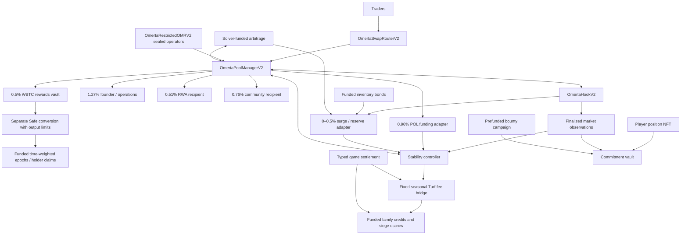

# OMERTÀ Market

This is the restricted ETH/OMR market and its companion contracts. The replacement token binds to a reviewed settlement manager that charges mandatory revenue on every buy and sell, including swaps in alternative pools hosted by that manager. These files do not activate a live deployment, funded reserve, production signer, or game route.

`OmertaRestrictedOMRV2` seals the existing settlement/custody roles and receiving-only runtime pins. Later admissions require separate Safe proposals, a seven-day delay and runtime revalidation; they cannot rewrite existing permissions, the manager or fee policy. `OmertaPoolManagerV2` enforces the base trade fee and WBTC rewards charge in swap accounting. The hook retains market measurements and bounded opening/surge charges. Position custody, reserve policy, inventory bonds, family entitlements, player commitments, rewards claims and conversion, and solver execution have separate contracts.

## What is implemented

| Requested capability | Implementation | Exact meaning |
| --- | --- | --- |
| Mandatory LP trade revenue | `OmertaPoolManagerV2` | 350 bps on buys and sells in every supported ETH/OMR pool: 127 founder/operations (`dev`), 51 RWA, 76 community, 96 POL. Rounding residual belongs to POL. |
| WBTC holder rewards | `OmertaWbtcRewardsV2`, `OmertaWbtcConverterV2` | An additional mandatory 50 bps on buys and sells funds the vault. Separate Safe conversions buy WBTC through a pinned external pool. Immutable funded periods use time-weighted wallet and backed-game balances; holders claim their Merkle allocation for network gas. The Safe attests the off-chain manifest. |
| Protocol charge ceiling | `OmertaPoolManagerV2` | Rejects a positive post-swap hook surcharge above 50 bps of the actual raw swap delta, enforcing at most 450 bps including the 350-bps base and 50-bps rewards charge across reviewed hooks. LP fees are additional. |
| Enforced settlement boundary | `OmertaRestrictedOMRV2` | Fixed-supply token and one settlement manager. Existing roles/runtime pins remain fixed after sealing; reviewed additional contracts require a seven-day admission process. Ordinary wallet transfers and unapproved venue funding fail after sealing. |
| Wallet swap entry point | `OmertaSwapRouterV2` | Direct payer-to-manager OMR settlement, actual fee-adjusted limits, exact input/output and partial-fill accounting. |
| Surge response | Hook pressure accumulator | Additional 0–50 bps on sells, paid exclusively to stability. Tick pressure decays over time. Buys cannot instantly erase accumulated pressure. |
| Anti-snipe | Immutable opening policy | A bounded opening block window, at most 50 bps additional buy fee, and optional actual quote-size limit. The window cannot be extended by an administrator. |
| Market measurements | Hook epochs + `OmertaMarketStateV2` | Fixed-interval mean tick, tick dispersion, gross ETH turnover, volume imbalance, minimum active liquidity, and liquidity-time integration. |
| Olympus-inspired RBS | `OmertaStabilityControllerV2` | Separate downside/upside range inventory, finite capacity, cooldown, stress hysteresis, spaced X-of-Y recovery observations, funded partial regeneration. |
| POL | Controller Core | Actual PoolManager-owned two-sided positions and principal/fee separation. |
| Lower Cushion / Garrison | Controller compartments | ETH inventory placed above the reference raw tick to absorb OMR selling. |
| Upper Cushion / Desk | Controller compartments | OMR inventory placed below the reference raw tick to supply OMR into buying. |
| War Chest | Controller compartment | Idle funded inventory; no direct range deployment. Funds regeneration without resetting lifetime limits. |
| Large-buy bonds | `OmertaInventoryBondV2` | Existing OMR inventory sold for ETH with bounded discount, sale limits and linear vesting. No mint authority or sellback quote. |
| MEV/arbitrage participation | `OmertaArbitrageV2` and solver tooling | Solver-bound commit/reveal, atomic two-pool ETH/OMR cycle, minimum realized profit, fixed reserve share, caller collateral returned through claims. |
| Family Turf | `OmertaTurfV2` | Fixed seasonal price slabs; protocol principal stays in the controller; families receive funded LP fee credits. |
| Syndicates | Turf splits | Up to four families, exact 10,000-bps share total, prospective ownership. |
| Sieges | Turf + game adapter | Frozen defender/attacker treasury addresses, bounded duration and victory allocation, funded fee escrow, replay/revision checked resolution. |
| Corridors / loyalty / fortification | Bounded Turf status | Corridors require touching adjacent ranges with matching owners. Status is game data and never multiplies a monetary claim. |
| Historical fee ownership | Turf bridge + game adapter | LP collection and fee forwarding occur atomically before ownership, siege or treasury transitions. |
| Player liquidity commitments | `OmertaCommitmentVaultV2` | Actual canonical PositionManager NFT custody, finite lock term, two-epoch sampled useful-depth accounting, funded rewards, independent maturity exit. |
| Budgeted upkeep | `src/marketv2keeper.js` | Closed typed jobs, runtime pins, one-block reads, simulation, one new transaction per invocation, durable existing PostgreSQL transaction transport. |
| Deployment and rewiring | `tools/market-v2-deployment-plan.js` | Offline constructor/binding/initialization/funding transaction plan with deterministic address calculation. |

The contracts expose the market facts and bounded game settlement needed for the seasonal map and its presentation. Story authoring, combat adjudication, UI weather, broker-house interfaces, and off-chain family decisions remain server responsibilities. These contracts do not assert that those presentation or gameplay features have been installed in the production console. Leveraged family debt and transferable securitization of future family revenue are outside the implemented market; the implemented bonds are funded inventory sales. DNR remains a separate denomination and system.

## Taxes and routing

The manager charges a 350-bps base plus a separate 50-bps WBTC rewards allocation on the actual unspecified-side swap delta for both buys and sells, including partial fills. Both charges are independently rounded down. For exact input they reduce output; for exact output they increase required input. Its accounting records independent founder/operations, RWA, community, POL and rewards buckets for both ETH and OMR, and requires the caller to settle the fee-adjusted debt before unlocking ends. The manager rejects any positive post-swap hook surcharge above 0.5% of the raw delta, enforcing a maximum 4.5% protocol charge per swap across reviewed hooks. The canonical hook uses that bounded addition for opening or sell surge and does not collect the base or rewards twice. The proportionally scaled founder/operations share is 1.27%, with 0.51% for RWA, 0.76% for community and 0.96% for POL. Largest-remainder rounding makes these base shares sum to 350 bps; base allocation dust belongs to POL. These percentages use the actual raw swap delta, not a promised percentage of a trader's gross payment or net receipt. A multihop or arbitrage cycle pays on each executed swap. Never assume every receipt is ETH. LP fees are additional and are explicitly selected in the PoolKey.

Each manager bucket can be swept to its fixed recipient independently. A recipient may claim its own bucket to another destination while the manager is locked. A failed recipient does not stop swaps or unrelated bucket claims. The canonical hook applies only its bounded sell surge or temporary opening buy charge, with separate accounting; it does not repeat the manager's base fee. Recipient addresses, base rates, maximum surge, and opening policy are immutable.

Keeper manifests use `manager_claim` against the pinned `OmertaPoolManagerV2` runtime for base buckets 0–3, separately for ETH and OMR. `hook_claim` bucket 4 delivers canonical opening/surge revenue. A Core `funding_flush` job can forward the POL bucket only after the manager sweep delivers it to the funding adapter.

The replacement token's sealed policy restricts direct OMR transfers to reviewed typed operators and its bound manager, with a separate receiving policy for the pinned genesis Safe, live operators, reviewed receiving-only contracts and self-enrolled undelegated EOAs. The manager supports native ETH/OMR pools, including unhooked alternatives; its 3.5% charge applies in every supported pool. JIT liquidity does not exempt a swap. Liquidity additions and withdrawals do not incur the base trade fee. Unsupported deployed or counterfactual contracts cannot directly receive native OMR. Independent managers, other token pairs, arbitrary routers and ordinary wallet transfers are outside the supported settlement path. Wrapper claims, custody IOUs, internal ledgers and EIP-7702 delegation after receiving tokens remain outside this guarantee.

Route the manager's 0.96% POL bucket to a Core `OmertaReserveFundingV2` instance. Route hook additions, inventory-bond proceeds and the arbitrage reserve share to a War Chest funding instance. Non-Turf LP fee recipients may also be that reserve instance. `flush()` forwards actual received ETH/OMR into the fixed compartment. It grants no new deployment capacity. The RWA, founder/operations (`dev`) and community recipients remain explicit deployment inputs; downstream source-specific revenue policies remain separate.

A funding adapter can route future inflows to a reviewed successor controller through a separate Safe proposal and seven-day delay. Activation rechecks its runtime, live `ProtocolCustody` admission, Safe, token, manager, PoolKey, market-state source and the selected compartment's fee recipient. The adapter first flushes all held ETH/OMR to the old controller, then switches future inflows. It transfers no old principal, fee liability or consumed capacity. Token admission and funding succession are separate proposals; initial launch must have neither pending.

This requires deploying `OmertaRestrictedOMRV2`, `OmertaPoolManagerV2` and a PositionManager paired to that manager. It cannot be retrofitted through `ammPairs(PoolManager)` on an existing ERC20. Every initial operator must exist with its reviewed actual runtime before the Safe binds the manager and seals the initial policy; bootstrap and protocol funding follow sealing. Live checks must establish an empty operator registry before binding, then compare the complete `operatorCount()`/`operatorAt(index)` registry and each role/runtime pin with the manifest immediately before the seal. Enumeration includes revoked entries, which cannot hide earlier permissions. Initial launch requires no pending policy proposals. Later additions require a Safe proposal and seven full days before activation, with the deployed runtime checked again; the Safe can cancel a pending proposal. Existing entries cannot be revoked or have their roles/runtime hashes changed after sealing, and manager/fee policy cannot be replaced. The offline plan emits launch conditions and does not perform live verification. Manager ERC6909 claims cannot be transferred into a substitute trading asset. See [restricted market bootstrap](RESTRICTED-BOOTSTRAP.md) for the staged deployment and migration boundary.

The receiving-only registry must likewise begin empty and match every `contractHolderAt(index)`/`contractHolderRuntimeHash` entry immediately before sealing. POL funding, reserve funding and the Turf fee bridge need receiving pins, with no transfer authority. Contract treasury recipients and public smart wallets require explicit holder entries before receiving OMR; new contracts after sealing follow the same seven-day proposal process. A proposal grants no receiving permission until activation. Other configured fee/family recipients self-enroll as undelegated EOAs; the swap router enrolls direct EOA payers. Genesis Safe is pinned separately and receives no operator role.

The entire fixed 100,000,000 OMR supply must remain with the Safe until sealing; the token rejects a seal while any inventory is outside its owner. This prevents a foreign manager from receiving genesis inventory and creating internally traded claims before restrictions begin. The planner requires the capital provider to be the Safe and moves LP/controller/bond inventory only after sealing through typed operators. It provides no independent-provider distribution path.

Swap revenue and LP fee revenue must be forecast separately in ETH and OMR. An OMR receipt or funding-adapter flush does not create ETH support capital. Taxable manager swap volume also differs from changes in economic exposure: a transferable LP position NFT can carry OMR exposure without a taxed swap. Inventory bonds and commitment campaigns are optional finite subsidies funded from explicit inventory and ETH budgets; neither deployment nor a nonzero capacity establishes funding. Arbitrage revenue depends on profitable solver participation after both swap legs and other costs. See the [economic remediation record](../../../output/economic-fixes-2026-10-17/REMEDIATION.md) for the funding boundaries and stress scenarios.

## Genesis liquidity handoff

The public-only coordinator uses the accepted sale's volume-weighted ETH-per-OMR price, bounded between the auction floor and final clearing price, for `liquidityPriceX96()`. The upper bound prevents integer token-count rounding from crossing the final price. The final clearing price remains separately available through the existing `playerPriceX96()` ABI. Matching reserve sufficiency and a graduation threshold large enough for at least one cleared token atomic unit at the maximum bid price are checked before public auction binding and funding; neither a positive reserve nor later retry establishes a safe sale configuration. Bid owners must already satisfy the restricted-token receiving policy when a bid is accepted.

The initial PositionManager NFT remains with the coordinator until successful migration, the auction's native claim cliff and 90 days after migration. Once all three conditions hold, anyone may call `releaseLiquidity()`, which transfers it only to the fixed `liquidityOwner`. During custody, earned LP fees can be collected without releasing principal. After release, the owner can remove liquidity; release does not wait for every buyer to claim.

## Price coordinates and finite inventory

The canonical order is native ETH as currency0 and 18-decimal OMR as currency1. Raw pool price is OMR per ETH. Increasing raw ticks means OMR is cheaper in ETH. Therefore an ETH-funded downside range lies **above** the raw reference tick; an OMR-funded upside range lies **below** it.

All active positions are reversible inventory. A fully converted ETH range can convert back if price returns before liquidity is removed. `finalize` performs the actual removal when a directional position has converted and the block condition is met. A graphical wall being crossed is not a settled inventory event.

Controller accounting separates idle ETH/OMR, deployed principal, returned principal, earned fees, current episode capacity, and lifetime deployment. The PoolManager's `callerDelta - feesAccrued` determines principal. Fees cannot be used as evidence of principal gain. Neither funding nor removing a position restores episode capacity.

Recovery uses unique epochs and a minimum time separation. After a complete Y-sample window contains X healthy samples, eligible recovery moves actual idle War Chest assets into the target compartment and replenishes only the bounded amount permitted by configuration. Lifetime deployment limits remain consumed. A recovery in market price never creates ETH reserves.

Core, Lower Cushion, Garrison, Upper Cushion, Desk and Turf each hold at most one active position per controller. Each controller's Turf range belongs to one immutable season and slab. Additional seasons or slabs use reviewed new controller/bridge instances with their own immutable budgets, explicit funding and completed delayed policy admissions. They cannot silently share principal or fee authority or reset an older controller's consumed lifetime limits. Existing obligations remain with their original contracts until settled.

## Observations and adversarial limits

The hook integrates the previous tick/liquidity state over elapsed time before updating it from swap or liquidity callbacks. It publishes completed fixed epochs. Idle gaps are processed in bounded work and do not carry ancient volume into a fresh epoch. A same-block liquidity appearance does not manufacture an epoch of minimum depth. A genesis partial epoch does not qualify as a complete observation.

Market state consumes the completed interval outside swap settlement. It floors negative mean ticks correctly and computes a nonnegative tick-dispersion measure. Sell imbalance is attenuated by turnover relative to observed virtual ETH depth so a dust-only sell interval cannot report maximum stress. This is a bounded risk input; wash trading remains possible.

The oracle is historical pool information. It is not an external fair-value oracle. Minimum raw liquidity is a participation gate, not a proof of executable depth through the full range. Controller and bond execution additionally check actual spot deviation and actual current liquidity. Sustained manipulation, market losses and adverse selection remain economic risks constrained by finite inventory and limits.

Anti-snipe is per swap, not per human. A user can split trades or use several accounts. Commit/reveal binds a solver's plan to its address; it does not grant exclusive arbitrage, private order flow, or immunity to competing trades. On-chain minimum profit rejects a losing cycle; the solver can still pay gas for a failed transaction. These contracts do not prove a market cannot surge or fall.

The canonical hook uses a fixed LP fee policy. Its additional pressure charge is a hook fee. Supporting dynamically overridden LP fees would require a separately specified pool policy and fresh review; it does not alter the manager's mandatory base revenue.

## Family fees, game authority and seasons

Turf ownership is a right to future funded fees, with no right to remove LP principal. Family IDs map to treasury addresses and revisions. Every deposit resolves the then-authorized recipients, so already credited balances never migrate when a treasury changes.

Use `OmertaGameSettlementV2` as the registry's immutable game address. The adjudicator can submit typed ownership, siege and status outcomes with expected revisions, snapshot epochs and replay IDs. It cannot withdraw controller principal, choose arbitrary calldata, create fees, or replace the registry. The Safe creates seasons and ranges before they start. One bridge is bound to one lane; bindings and game-lane registration are completed before the season starts.

Before a takeover or siege begins, the adapter checkpoints that lane. Before a treasury wallet changes, it checkpoints every active lane, bounded to 64. This is intentional operational coupling: a failed source can delay a wallet change, while already credited claims and trading remain independent. Expired lanes can be closed and archived to free capacity for later seasons.

A siege freezes participant wallets and allocates only funded escrow. Expiry makes the default-defender outcome callable. The last accrued fee batch is credited to the frozen siege wallets before its snapshot is cleared. The economic cutoff is the **atomic on-chain checkpoint**, not a retrospectively inferred off-chain timestamp. Permissionless expiry must pass through the adapter. Season expiry removes the actual Turf position without consulting the oracle or pause state; fees earned until that transaction are still assigned to the recorded lane. Principal returns to that controller's Turf account for Safe retirement.

Off-chain receipts must identify chain, registry, season, turf, revision, epoch and a unique settlement ID. Registry replay protection is scoped to that lane. Public logs are chain evidence; an indexer must apply the chain's confirmation and reorg policy before displaying a game settlement as final. These logs do not authorize the ordinary game cash ledger to pay anything.

## Player commitments and bonds

The commitment vault accepts only actual PositionManager NFTs for the canonical pool. Custody prevents the original owner from removing liquidity during the agreed term. A subscribed, empty, foreign-pool or previously committed NFT is rejected. Maturity withdrawal is available to the depositor without querying the market oracle or requiring rewards to be claimable.

Rewards require two distinct, fresh, qualifying observations. Useful depth is conservatively sampled on both sides of a bounded reference band; the smaller adjacent sample bounds credited depth-time. Invalid samples, gaps or pause transitions break accrual. This does not prove continuous range occupancy. Each campaign is one immutable prefunded reward epoch. Checkpoints record useful depth-time without per-NFT depth or reward caps. After campaign expiry plus the maximum observation gap and publication age, finalization reserves the entire earned reward pot before claims or recovery. The pot is capped by actual funding, the epoch reward ceiling, and the rate applied to globally capped depth-time. Each position receives its recorded share pro rata, with conservative rounding; splitting equivalent exposure across NFTs or accounts cannot increase aggregate entitlement. Settlement is permissionless and credits the original depositor even after NFT exit. Rounding dust stays reserved; recovering unused budget cannot consume unsettled rewards.

Inventory bonds accept ETH only when sufficient OMR is already funded. A purchase reserves its complete future entitlement immediately, with per-purchase, per-epoch and lifetime limits in both assets and an absolute rate bound. New bond contracts start paused. Safe activation remains separate; discounts cannot exceed 0.5% and nontransferable notes vest linearly over at least 30 days. Pausing purchases, exhausting inventory or losing the oracle does not block a vested claim. The contract cannot mint tokens or buy them back from note holders. Selling vested OMR through a supported pool incurs the mandatory trade fee.

## Operational scope

The keeper is a bounded command, suitable for an explicitly configured external scheduler. It does not schedule itself or run indefinitely. Its plan mode needs no signing key and performs read-only RPC simulation. Run mode uses the existing shared PostgreSQL nonce/transaction journal: signed bytes are retained before broadcast, ambiguous transactions reconcile before any new transaction, and daily gas is bounded. Market capital and fees are accounted on chain; this transport does not book them into the game cash ledger.

The solver compares approved alternative pools hosted by the same manager. Quotes must include mandatory revenue on both legs, canonical hook additions when applicable, all LP fees, a configured gas allowance and minimum solver profit after reserve sharing. It persists an exact plan before commitment. Reveal must use that same plan within the on-chain window. A quote is an estimate at a pinned block; execution still revalidates actual realized profit.

Deployment parameters, real reserves, initial price, initial liquidity, recipient custody, epoch length, range width, campaign economics and solver profitability are not inferred from branding or invented by the implementation. The schema-2 example manifest is a local-chain test fixture with synthetic runtime hashes. Before a funded release, measure those parameters on the intended chain, reproduce the plan on a fork, and retain the exact actual-runtime/configuration checks. Follow [restricted market bootstrap](RESTRICTED-BOOTSTRAP.md), the applicable companion operations in `RUNBOOK.md`, and the scoped review package. Supplied public runtime hashes and an unsigned plan alone do not verify a live deployment or authorize activation.

## Primary references

- [Uniswap v4 hooks](https://developers.uniswap.org/docs/protocols/v4/concepts/hooks): pool hooks and their callback permissions.
- [Uniswap v4 dynamic fees](https://developers.uniswap.org/docs/protocols/v4/concepts/dynamic-fees): LP fee policies are distinct from this hook's tax accounting.
- [Olympus range-bound stability](https://docs.olympusdao.finance/main/overview/range-bound): inspiration for finite capacity and regeneration. Its documentation currently describes RBS as disabled and replaced by YRF plus the Emissions Manager; this implementation does not claim to deploy Olympus's current system.
- [Uniswap range orders](https://developers.uniswap.org/docs/sdks/v3/guides/managing-liquidity/range-orders): concentrated inventory can reverse until liquidity is removed.

The source and test evidence in this repository determine this implementation's behavior. The references explain underlying mechanisms and do not constitute security clearance for OMERTÀ.
